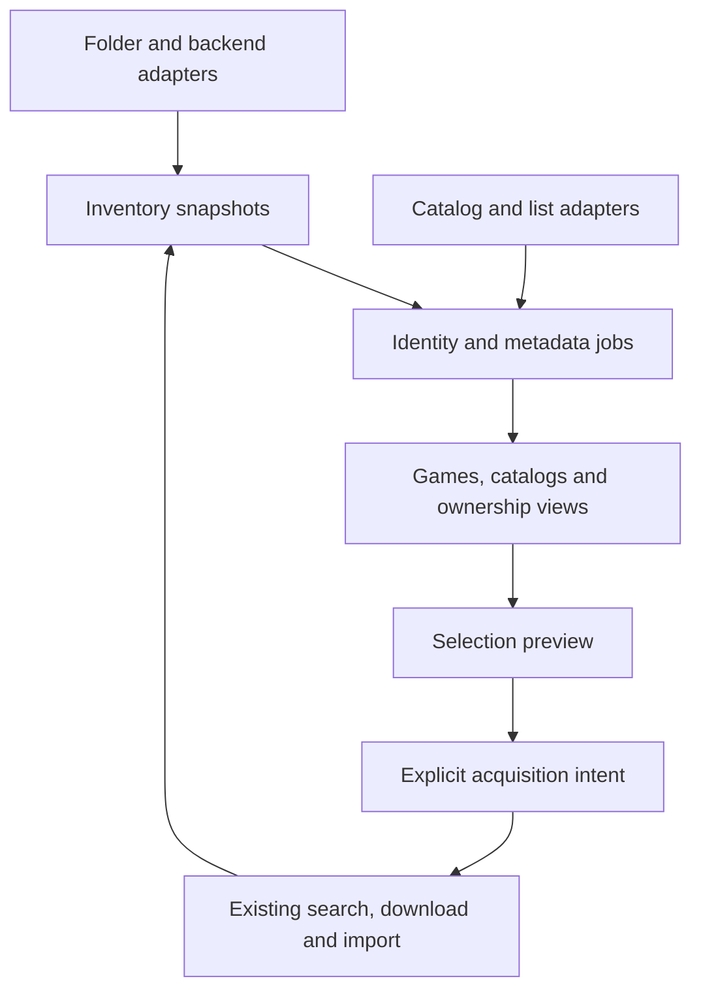

# Architecture, data and contracts

**Decision confidence: moderate.** These choices fit the inspected Python service and reported scale. The migration, fault-injection and resource gates in [verification](06-verification.md) are required before enabling the new paths by default. Names of new modules/endpoints below are proposed; existing contracts named explicitly are preserved.

## A1. Extend the current application through small services

Keep `ROMarr` as the composition root, the existing HTTP/auth layer, the Python-rendered UI, existing acquisition pipeline and backend factories. Extract new domain logic into focused modules so `app.py` and `ui.py` do not absorb another large independent subsystem.

| Proposed module | Responsibility | Reuse |
| --- | --- | --- |
| `inventory.py` | Stable source occurrences, complete snapshots, ownership query, library/system facets | `libraries.Game`, backend factories, `hashes.py` |
| `platform_mapping.py` | Canonical slugs, scoped mappings and evidence/conflicts | `platforms.resolve`, `sniff`, DAT/header identifiers |
| `media_sets.py` | Logical file groups and completeness | Existing archive/disc handling in `library.py`, `sniff.py`, platform media declarations |
| `catalog_store.py` | SQLite schema, migrations, bounded queries/transactions | Python `sqlite3`, existing data-directory configuration |
| `jobs.py` | Durable leases, work items, cancellation, retry and progress | `scheduler.py` as timer/dispatcher; do not introduce Celery/Redis |
| `enrichment.py` | Candidate matching, field provenance, overrides and projection | Existing provider transports in `metadata.py` |
| `artwork.py` | Bounded image cache and authenticated delivery | Existing HTTP/path validation conventions, separate from ROM asset authorization |
| `search_service.py` | Shared search context, evaluation and snapshot diagnostics | `_search_releases`, `judge`, `best_release`, profiles/blocklist, `grab` |
| `catalog_sources.py` | Catalog adapter capabilities, source snapshots and crosswalks | `dat_catalog.py`, `metadata.py`, `titled.py`, list parsers |

Do not require new methods on the existing `Library` protocol. Optional capability methods can be discovered through a wrapper with conservative defaults. Old third-party backends continue to satisfy their existing protocol. Change one seam at a time; a module split is justified by the feature, not an invitation to refactor unrelated code.



## A2. Identity precedes enrichment and automation

Use four distinct concepts:

1. **System:** existing canonical slug, e.g. `psx`/`ps2`; display names, aliases and provider IDs are mappings. Never rename published slugs to make UI labels prettier.
2. **Catalog release:** one provider identity for a game on a system, plus edition/region/revision relationships when known. Provider game IDs may span platforms, so `(provider, entity ID)` alone is not always a release identity.
3. **Library item:** one observed copy/media set in one configured library. Give it a stable opaque `itemId`; preserve source backend ID privately. An unmatched item still exists and remains browsable.
4. **Files/assets:** one or many files supporting that item, with roles (entrypoint, track, disc, patch, auxiliary), fingerprints and completeness. These are not independent shelf games by default.

Persistent library IDs come from stored configuration IDs, not editable labels or list position. Backend identity is `(libraryId, backend kind/namespace, external ID)`. Folder locators are normalized relative paths **without case folding the stored path**; `itemId` is a database-assigned ID. Identical backend IDs in two libraries cannot collide.

A rename/move may retain identity only with an explicit operation or unambiguous corroborating evidence. Device/inode and size/mtime are hints, not durable identity across network mounts or replacement files. Content hashes establish byte identity when measured; they do not merge different libraries, variants or personal notes automatically. Preserve unresolved old records for review instead of reattaching notes to a similarly named sequel.

Keep original filenames, title strings and provider values. Normalize separately for search/matching. Namespace all external IDs and support redirects/aliases for provider merges. Preserve `dat_catalog._entry_key()` exactly for SeerrNG v2; new internal IDs may reference it but never replace its public key.

## A3. Resolve systems through evidence and explicit scope

For folder scans, gather evidence in a deterministic order: explicit per-item override; explicit path-prefix/one-system configuration; reliable backend/provider identity; recognized manifest/header/DAT identity; exact known folder/root alias; unambiguous extension. Record all evidence, the selected result, confidence and conflicts. A root-name guess is a suggestion until saved by the operator. A shared `.iso`, `.bin`, `.chd`, `.zip` or `.pkg` extension cannot choose a system alone.

Explicit configuration determines intended organization, but contradictory strong content evidence must surface a conflict and prevent automatic importing into the wrong system. Do not silently discard the override or claim the file is safe because the operator picked PS1. Unknown, conflicting and unsupported are separate states. Metadata title matches never override stronger system evidence.

Define a typed resolution result: `slug | null`, `status` (`resolved`, `unknown`, `ambiguous`, `conflict`, `unsupported`), `evidence[]`, `candidateSlugs[]`, `ruleRevision`. Keep provider platform ID, provider label and mapped canonical slug separately. Use scoped alias maps (backend/provider or library/path), not a global fuzzy resolver. Fixing “Favorites → psx” for one root must not change every source named Favorites.

Extend library configuration additively with `scan_mode`, `scan_platform`, `scan_mappings` and a scan-layout descriptor. Preserve existing `platforms` as import routing. Represent destination layout independently, including a one-system root destination. Default old configs to their prior semantics; propose a reviewable repair for suspected root-level libraries.

## A4. Inventory is durable and scan publication is honest

A scan writes a new generation in bounded transactions. The last complete generation remains authoritative while new observations arrive. A partial generation can be browsed with its status, but absence from it never means missing. Commit a complete generation atomically only when all expected pages/files in its scope were processed. For remote backends, track total/count/cursor stability where available and flag inconsistent pagination rather than claiming a complete snapshot.

Each scan has library/config revision, generation ID, start/finish, visited files, emitted items, excluded/unsupported counts, failures, truncation and checkpoint. Never infer an exact count from reaching `MAX_SCAN` or a page cap. Permission failures, offline mounts and timeouts preserve previous data. Deletions become tombstones only after a successful complete scan of the relevant scope; a whole-library outage cannot delete its inventory. Optional filesystem watchers invalidate/coalesce work; periodic reconciliation remains authoritative for SMB/NFS and external writers.

Turn the current total walk ceiling into bounded resumable work, rather than permanently hiding everything after item 50,000. Checkpoints include a bounded directory/page frontier and generation/config revision; invalid checkpoints restart a read-only generation without deleting the last complete one. An operator-selected total resource limit may still produce a partial inventory, which must block absence-based bulk acquisition. Never remove the bound and replace it with an uninterruptible walk.

Coordinate with PR #58: one bounded filesystem traversal per generation supplies count and pages. Add single-flight synchronization, cancellation/invalidation revisions and publication ownership so a stale refresh cannot overwrite a newer one. Cache TTL is not a consistency boundary for a multi-page scan. Counts, facets and detail must identify the generation they describe.

Use one scoped ingestion path for scanner discoveries and successful imports. Import completion can upsert/invalidate that item immediately without forcing a full tree walk. Group CUE/BIN tracks and M3U discs by validated references; report missing members as incomplete. Do not double-count both a playlist and every referenced disc as separate games. Standalone ambiguous files can remain separately visible until a safe grouping exists.

## A5. Storage and transaction boundaries

Add an indexed SQLite sidecar next to the configured state file, named `romarr-catalog.sqlite3` by default. The state-file parent, not a guessed `/config`, determines its location unless explicitly configured. Keep credentials, instance settings, legacy Wanted/queue/history and SeerrNG state in `Store` for the first rollout. No external database process is introduced.

Large catalog/inventory data, provenance, overrides, new jobs and selection previews live in SQLite. This avoids putting hundreds of thousands of rows in every JSON settings rewrite. Use one migration owner and one serialized writer, short write batches, per-thread read connections, foreign keys and a busy timeout. Default to rollback journaling for portability; enable WAL only on a qualified local persistent filesystem. An unsafe/unwritable state volume gets a clear diagnosis; do not silently relocate persistent state to ephemeral storage. Benchmark both journal modes on the supported deployment matrix. Do not require FTS5 without capability detection; indexed normalized fields provide a fallback.

Logical schema (DDL belongs in `R05`, after contract fixtures):

| Table/family | Keys and invariants |
| --- | --- |
| `schema_migrations`, `instance_metadata` | Monotonic schema version, migration checksum, instance ID, imported legacy fingerprint; newer unsupported schemas fail closed without destroying files. |
| `library_sources`, `scan_runs` | Stable library ID, backend namespace/config revision, immutable generation/checkpoint, completeness and errors. Config is a projection; secrets stay out. |
| `items`, `item_observations`, `media_files` | Stable item ID; unique source locator per library/generation; file roles; current locator aliases; evidence/status; no path exposed in shared projections. |
| `catalog_sources`, `catalog_snapshots`, `catalog_releases`, `catalog_variants` | Namespaced source IDs, source version/hash, complete/partial scope; system/edition/variant identity; stable public DAT key reference. |
| `external_ids`, `match_candidates`, `item_matches` | Provider/entity/system keys and explicit many-to-many crosswalks; unique selected match per item/provider/context, confidence/evidence/revision. No title-only global unique key. |
| `metadata_fields`, `field_overrides`, `artwork_assets` | Source, fetched-at, expiry, language, precision, value and lock per field; artwork content hash/MIME/dimensions/size/provenance. Keep old good values on transient failure. |
| `personal_state` | Stable item or explicitly chosen catalog-release scope, notes/rating/status, revision; legacy key reference retained. |
| `saved_lists`, `list_members`, `list_sync_runs` | Versioned membership, source item key, exclusion/tombstone and automation policy; one import does not imply monitoring. |
| `jobs`, `job_items`, `selection_previews` | Durable states, generation/policy, cancellation epoch, leases and attempts; immutable scoped preview with expiry. |
| `acquisition_outbox` | Unique operation ID and target identity; pending/acknowledged/uncertain; links to legacy Wanted/queue or integration request identity, never a claim of distributed exactly-once delivery. |

Indexes must cover `(libraryId, systemSlug, normalizedTitle, itemId)`, current observations, selected matches, provider IDs, catalog snapshot/system/genre membership, job state/next attempt and idempotency keys. Genre membership is normalized to a join table for filtering; keep the provider vocabulary too. Avoid per-row provider calls or JSON parsing during ordinary browse.

### Bridging JSON Store and SQLite

There is no atomic transaction spanning the two files. Make the boundary explicit:

1. Commit a selection job plus an outbox operation in SQLite. Operation IDs are stable for retries of the same committed selection.
2. A worker takes a lease, validates current identity/policy/capacity, and asks a Store facade to create/return the corresponding Wanted/acquisition intent under its existing lock.
3. The facade persists an operation-ID marker and the state change together using a **strict save** path that raises on write failure, restores in-memory state on failure and meets the chosen flush/fsync durability policy. Extend this narrowly; do not claim existing `save()` already supplies that guarantee.
4. Acknowledge the outbox only after durable success. If the process dies between steps 3 and 4, replay returns the recorded result rather than duplicating the intent. Retain operation markers while any job/outbox replay can refer to them.
5. Network handoff to a client is a separate non-transactional boundary. Persist the dispatch identity before sending; reconcile a lost response by client ID/infohash or other supported stable identity. If the client cannot reconcile, mark the result uncertain for operator review. Do not blindly resend a mutation after a timeout.

Do not enqueue a whole platform into the current capped queue or SeerrNG request table. Keep pending catalog/batch items in the new job store; admit bounded active work. Add backpressure at Store admission so new bulk work cannot cause the existing queue cap to discard live entries. Observe legacy/manual work too. New local bulk workflows must not repurpose externally owned SeerrNG IDs or exhaust its request retention limit.

## A6. Metadata matching and field resolution

Extend provider adapters with capabilities: ID lookup, candidate search with system constraints, catalog enumeration, genre vocabulary, artwork and optional rate/coverage information. Reuse IGDB token exchange and process-wide limiter, plus current RAWG transport; do not create another credential cache. Legacy `Metadata.identify()` remains a compatible wrapper for callers while the new enrichment flow returns structured candidates.

Matching sequence:

1. Respect a selected/locked provider ID. Refresh that entity; do not title-search it again unless the identity disappeared or the operator requests re-identification.
2. Use trusted backend IDs or reviewed local metadata IDs with a validated system crosswalk.
3. Use a verified DAT/serial identity to derive the right release/title and candidate constraints; the DAT hash alone is not an IGDB ID.
4. Search normalized title plus system, keeping meaningful edition/revision/region qualifiers as structured evidence. Escape provider query syntax. Fetch a bounded candidate set, never just the first answer.
5. Reject incompatible systems/editions; rank using title aliases, release/region/serial evidence. Auto-accept only an unambiguous rule with measured precision. Initially exact trusted IDs/system mappings and unique strongly corroborated candidates qualify; fuzzy-only/tied results require review.

Use `high / moderate / low / unknown` confidence with reasons. Do not expose uncalibrated scores as probabilities. Calibrate automatic matching against fixtures and sampled real operator-approved matches before broadening rules. Low-confidence results cannot drive ownership suppression or automatic acquisition decisions.

Field precedence defaults to manual lock → validated local sidecar override → chosen backend's metadata → selected provider chain. Make the local/backend precedence configurable per library when needed; persist the rule used. Absence does not erase a good value; an intentional clear is a tombstone. Rating scales, genre aliases, date precision and language are normalized with their originals retained. Missing provider genres are unknown, not an empty authoritative classification.

Artwork downloads are a separate job step so a valid identity can complete while art retries. Cache content-addressed bounded images with quota/LRU for unreferenced assets, retain locked/selected artwork, use conditional requests when supported, and serve from an authenticated local endpoint. Validate MIME and decoded dimensions, cap response/decompression sizes/time/redirects, and reject active content. Do not turn arbitrary cover URLs into an unrestricted URL proxy. A backend requiring cookies/headers for covers is fetched only through its configured adapter and origin policy; never send those credentials to a CDN redirect.

New/changed items enqueue scoped enrichment only under the saved policy. Use positive/negative caches keyed by provider, entity/search context, locale and mapping revision. Retry transient/network/429 errors with bounded exponential backoff and jitter; honor `Retry-After`. Invalid credentials pause that provider until repaired. A no-match result is not a transport failure and should not be retried each page load. Explicit refresh can invalidate a selected cache scope.

## A7. Durable jobs and cancellation

Job states: `queued`, `running`, `waiting_retry`, `blocked`, `paused`, `completed`, `completed_with_errors`, `cancelled`. Work-item outcomes describe actual domain progress: metadata matched/art cached/review required; batch wanted/dispatch accepted/downloading/imported/already present/failed/uncertain. A completed worker pass is not a completed acquisition.

Use durable leases with owner, expiry and heartbeat; only the current lease/cancellation epoch may commit progress. Recover expired leases after restart and reconcile external side effects before replay. Deduplicate `(job kind, scope revision, item identity, options revision)`. Separate interactive work from background batches with bounded workers, per-provider limits and a low-priority large-scan/hash lane. Never hold a global Store/DB lock during network calls, full hashing or filesystem walks.

Pause prevents new work after the current safe boundary. Cancel increments an epoch and prevents new dispatch, while allowing reconciliation of already sent requests. Late success must not resurrect cancelled work or clear newer overrides. Deleting a library/provider blocks or cancels its pending tasks; tombstone references needed for history instead of attaching them to a different source. Jobs have bounded retained details and paginated errors; no logs containing credentials or raw private download URLs.

Initial configurable defaults for implementation/benchmarking (moderate confidence):

| Control | Starting value / semantics |
| --- | --- |
| Enrichment worker pool | 2 workers globally; provider rate/concurrency limits remain stricter ceilings shared with all other features. |
| Scan / full-hash workers | 1 active scan per library, 2 globally; 1 low-priority full-hash worker. No full hash required just to browse. |
| Database work batch | Up to 250 items or 100 ms of lock-held work, whichever is reached first; provider/filesystem work happens outside the transaction. |
| Retry policy | Up to 5 transient attempts, exponential delay from 5 seconds capped at 15 minutes, with jitter and `Retry-After` taking precedence; then expose retryable failure. Auth errors block immediately. |
| Negative match cache | 24 hours unless provider/mapping/identity changes or an explicit retry invalidates it. Positive metadata refresh policy remains separately configurable. |
| Job lease | 60 seconds with heartbeat at most 15 seconds apart; long operations renew outside DB transactions; expired dispatch leases require reconciliation before retry. |
| Selection preview | 30-minute expiry; at most 500 explicit IDs per request, or a server-side query selection up to 50,000 materialized items. Larger scopes require separate previews, never truncation. |
| Idempotency records | Same key + same canonical body returns original result; same key + different body returns 409. Retain through job lifetime plus at least 30 days; never prune while external reconciliation is unresolved. |
| Artwork | 10 MiB response and 40-megapixel decoded-image limits, 3 redirects, 20-second request timeout, 512 MiB default cache quota. Oversize images fail explicitly; selected user artwork requires protected retention accounting. |

Bounds must be configurable within safe ceilings and visible in diagnostics. Disk admission checks reserve room for migration, database growth and active downloads independently; a full artwork cache cannot consume the space reserved for state commits. Measure on the low-memory fixture and adjust with recorded evidence, not by silently raising every limit.

## A8. Ownership, catalogs and selection

One inventory query service answers presence for Games, Collections, Lists, Discover and SeerrNG's existing lookup projection. It reads the whole current snapshot, never `library_view()`'s first page. Return presence plus evidence/coverage/freshness; do not reduce unknown to false.

Presence states include `present`, `incomplete`, `missing`, `unknown` and `catalogued_only`. Verification is a separate enum (`verified`, `bad`, `unverified`, `unsupported`); acquisition is a separate state. When a caller requests a chosen variant/region, evaluate that scope; a PS2 edition does not satisfy PS1, and a partial multi-disc set does not satisfy completeness. A reviewed provider/DAT identity may establish ownership; loose title similarity can only suggest a match.

Catalog adapters declare enumeration and facet capabilities. A DAT snapshot is enumerable but lacks art/genre; IGDB catalog search/popularity is not proof that a platform enumeration is complete. Implement a separate bounded platform enumeration path with source-supported pagination/checkpoints before labeling its snapshot complete. Preserve legacy endpoint cursor limits; do not remove them merely to make a new catalog look exhaustive. Every provider page loop must progress and terminate, including sparse genre pages, duplicates, offset ceilings and repeated cursors.

Catalog snapshots contain source provenance, fetched/version hash, system scope, region/edition policy, complete/partial status, total-known/estimated counts and enrichment coverage. Pin source identities and mappings while a preview is in use. Crosswalk DAT entries to metadata without changing DAT IDs or silently collapsing clones. A refresh adds/removes membership by source identity; it does not rewrite user exclusions or delete files. Failed/partial source refresh retains the last good snapshot.

Bulk selection is represented server-side by a preview ID, source/inventory/policy revisions, filters, explicit inclusions/exclusions, counts and expiry. The commit carries the preview ID plus an idempotency key. Revalidate target identity, current presence and policy. Newly owned entries may be safely skipped with a per-item reason; changes that add targets or alter their variants require a new preview. Always materialize exactly the reviewed selection. Indexer searches begin only for the explicitly chosen action/policy.

## A9. API evolution

Keep `/api/v1/game`, `/api/v1/game/meta`, library configuration CRUD, `/api/request`, release routes, collection routes and both SeerrNG prefixes compatible. Add fields instead of repurposing `id`, `source`, `platform`, existing pagination or status meanings. In particular, keep provenance filtering under `source` and add `libraryId` separately. Canonical system filtering is new; keep legacy display-name filter resolution compatible and explicit. Never add admin routes to `OPEN_PATHS` or widen the SeerrNG provider key.

Proposed operator-only additions (register fixed routes such as `/game/meta` before parameter routes):

| Route | Contract |
| --- | --- |
| `GET /api/v1/capabilities` | Task/backend readiness, versions, supported auth/scan/metadata/playback features and safe reasons. |
| `POST /api/v1/library/scan-preview` | Existing configured or explicitly submitted root/mode; bounded, read-only preview with evidence. |
| `POST /api/v1/library/{id}/scan` | Idempotent async scan job; returns `202` plus job ID, never blocks HTTP for a tree walk. |
| `GET /api/v1/game/{itemId}` | Detail, provenance, selected metadata, copies/media and permitted actions. No secrets. |
| `POST /api/v1/game/{itemId}/identify` | Candidate discovery job or confirmed candidate selection with expected revision; separate operation kinds. |
| `POST /api/v1/metadata/refresh` | Explicit items or validated preview/scope, mode and idempotency key → job. |
| `PATCH /api/v1/game/{itemId}/overrides` | Field/system/match locks with optimistic revision; `409` on stale edit. |
| `GET /api/v1/jobs` and `GET /api/v1/jobs/{id}` | Bounded pagination, counters and safe errors. |
| `POST /api/v1/jobs/{id}/control` | Pause/resume/cancel/retry eligible failures; revision/idempotency checked. |
| `GET /api/v1/catalog/sources` and `/api/v1/catalog/games` | Sources/capabilities and snapshot-bound browse/facets; opaque cursor. |
| `POST /api/v1/selection/preview` | Validate a catalog/list/collection selection against inventory/policy; no acquisition side effects. |
| `POST /api/v1/selection/commit` | Preview ID, action and idempotency key → job/per-item intent results. |
| `GET /api/v1/artwork/{assetId}` | Authorized cached asset; no caller-supplied fetch URL. |

Update `openapi.py` and contract fixtures alongside each route. Error envelope: `code`, safe `message`, optional `retryable`, `retryAfterSeconds`, `jobId`, `correlationId` and field-specific `details`. Distinguish 400 malformed request, 401/403 auth, 404 unknown object, 409 stale/conflicting intent, 422 valid but unresolved mapping, 429 local admission limit and 503 temporarily unavailable. Do not translate machine codes; translate messages in the UI.

Example refresh request (opaque IDs are illustrative):

```json
{
  "itemIds": ["item_01", "item_02"],
  "mode": "fill_missing",
  "expectedInventoryRevision": "scan_12",
  "idempotencyKey": "operator-refresh-42"
}
```

New browse responses contain `snapshotId`, `items`, `nextCursor`, `total` (nullable), `totalRelation` (`exact`, `at_least`, `unknown`), `coverage` and freshness. Cursors bind the snapshot/filter/sort/tie-breaker; reject incompatible cursors explicitly. Maintain old endpoint response fields while adding this to new APIs. Bound query/selection sizes, request bodies, provider pages and job admission; reject excessive requests before allocation. Initial limits are release-tunable constants with documented error behavior, not hidden data loss.

## A10. Upgrade, backup and rollback

1. Stop writers briefly for a migration preflight. Validate paths, free space, permissions, current state readability and single migration ownership. Capture a consistent JSON/SQLite/manifest backup; use SQLite's backup API rather than copying a live WAL file alone.
2. Apply versioned additive schema migrations transactionally; record checksums. Import config projections and small legacy personal state by fingerprint. Do not schedule searches/downloads or perform a provider scrape during migration.
3. Rebuild inventory asynchronously from configured sources; keep old browse behavior until a valid generation is ready. Build metadata/catalog caches only on demand or under explicit enrichment policy.
4. Attach legacy personal metadata only on a unique canonical-system/title/occurrence mapping. Preserve ambiguous/unmatched keys in a review queue and the backup; never copy a note onto several unrelated games. Old `/game/meta` calls resolve through the compatibility facade; ambiguous writes return a reviewable conflict rather than changing multiple items.
5. Define a single authority for migrated personal state and an idempotent legacy projection/journal. Do not permit two independent writable copies. Include all overrides, matches and notes in backup/export; caches alone may be evicted, user decisions may not.
6. Add feature gates for inventory projection, enrichment and catalog automation. Disabling a gate stops new jobs and uses the compatible read path, but does not discard new state. Re-enabling resumes from checkpoints.
7. A binary-only downgrade is not a complete rollback. Quiesce jobs, reconcile dispatched work, export post-migration user decisions, and restore the matched prior binary/config/data snapshot. Keep the new database and delta journal for forward recovery. Demonstrate how current notes/overrides are exported/replayed rather than silently lost; nonrepresentable older-version fields remain in the recovery artifact.

The rollback exercise must prove no duplicate download, no broadened selection, no lost secrets/notes and no path changes. An inaccessible/corrupt sidecar must never reset instance authentication or recreate an unclaimed install. Existing jobs already handed to a client are reported and reconciled, not assumed cancelled by restoring a database.

Preserve current configuration-only backup/restore and encrypted-credential behavior. Introduce a versioned full-state archive/manifest that declares included state, schema/app version, checksums, secret policy and cache exclusions. Do not relabel the current settings backup as a complete recovery point. Restoring untrusted archives applies path/size limits and validates the entire manifest before replacing live state; missing-secret restores require explicit operator repair without clearing unrelated saved credentials.
