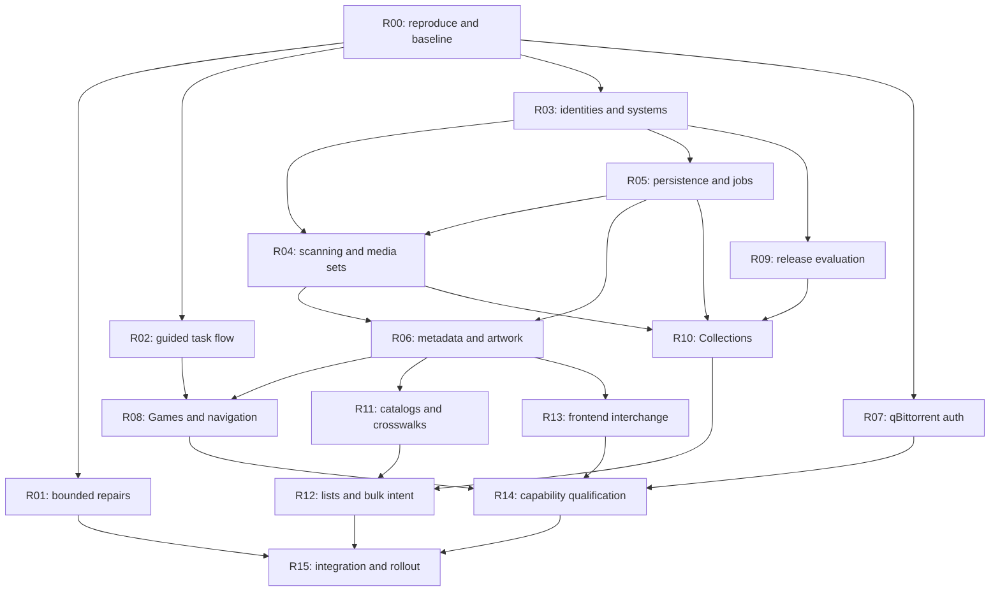

# Delivery plan and Luna implementation ledger

This ledger tracks implementation in [PR #60](https://github.com/snapetech-org/ROMarrNG/pull/60). Status means source evidence only unless explicitly marked runtime qualified or released. Confidence in ordering is **high**; complexity is relative, not a calendar estimate. Re-evaluate scope after the first real single-folder journey and the storage benchmark.

## Execution rules

1. Fetch current `main`, read `AGENTS.md`, inspect relevant open PRs and compare with the inspected base. Preserve intervening fixes. Recheck PR #58 before touching folder scanning and PR #56 before changing validation workflows. Do not merge them as an implicit part of this plan.
2. Implement one coherent packet or explicitly justified small combination per PR. Each PR names requirement IDs, changed contracts, migration impact, test evidence and limitations. Use the repository PR template and structured release-note fragments for behavior changes.
3. Update the ledger with implementation PR/commit, tests, fixture/backend versions and status. Use **pending → in progress → source complete → runtime qualified → released**, plus blocked where applicable. Source completion alone cannot satisfy a live compatibility claim.
4. Keep APIs compatible and new services behind their proposed facades. Run focused regression tests after changes; use the full offline suite at integration gates. Add behavioral tests for the gaps, not assertions that merely repeat the implementation.
5. Every GitHub Actions job uses compatible private ephemeral JIT runners as required by `AGENTS.md`. No hosted fallback or widened trust. If the private route cannot run, record the blocker and actual local evidence; do not mark CI as passed. Do not restart a broker with active guests.
6. Never test against production credentials, move real ROMs, reconfigure a user's library or send actual acquisition requests merely to validate a fixture. Live qualification uses an explicitly configured test environment and known harmless test payloads.

## Dependency graph

`R14` also depends on the shared acquisition contracts from `R09`; `R15` includes all packets and all regression gates even where not every edge is drawn. Work can be scheduled independently along the branches without changing the ordered acceptance boundaries. No delegation is required by this document.

## Ledger

| Packet | Priority / relative size | Depends on | Status | Implementation PR / evidence |
| --- | --- | --- | --- | --- |
| R00 — reproduce and contract baseline | P0 / M | None | in progress | PR #60: regression tests cover folder roots, metadata, collection status, catalog/Wanted and qB auth; 81 final focused tests pass. Full acceptance fixture/resource baseline remains open. |
| R01 — bounded correctness repairs | P0 / M | R00 | source complete | PR #60: explicit folder scan-system mapping, canonical platform slugs, complete-cache ownership checks and failed collection-result handling; focused regressions. |
| R02 — guided tasks and interests | P1 / M | R00 | in progress | PR #60: task/interests screen, task-scoped checklist/navigation and platform categories; full keyboard/mobile/RTL journey qualification remains open. |
| R03 — canonical identity and mappings | P0 / L | R00 | in progress | PR #60: canonical platform mapping plus per-library/item metadata keys; stable scan identities, provider crosswalks and typed DTO contract remain open. |
| R04 — scan snapshots and media sets | P0 / L | R03, R05, reconcile #58 | pending | No generation snapshots, checkpoints or logical media-set scanner delivered. Reconcile PR #58 before implementation. |
| R05 — durable store/jobs and migration | P0 / L | R03 | in progress | PR #60: SQLite metadata sidecar, legacy JSON migration and API-backup inclusion; durable jobs, leases, outbox, strict writes and scale/recovery gates remain open. |
| R06 — enrichment and artwork | P0 / L | R04, R05 | in progress | PR #60: per-game refresh/correction, saved metadata, opt-in recurring enrichment and detail UI; candidate review, provenance per field, bounded artwork cache and durable work remain open. |
| R07 — qBittorrent API keys | P1 / M | R00 | source complete | PR #60: env/config schema, bearer transport, no password fallback and auth regression matrix. Live supported-version handshake/transfer remains unqualified. |
| R08 — actionable Games and navigation | P1 / L | R02, R03, R06 | in progress | PR #60: game detail actions, category filters, task-focused nav and catalog links; source-library filters, cursor stability, 500+ UI journey and actual-file playability remain open. |
| R09 — one release evaluation contract | P0 / M | R03 | in progress | PR #60: Add New and Interactive Search share source fan-out; direct indexers included, failure summaries shown, and failed Add New can open prefilled results. Context snapshots and identical verdict/rejection diagnostics remain open. |
| R10 — reliable set planning/execution | P0 / L | R01, R04, R05, R09 | in progress | PR #60: invalid DAT/system checks and request-failure accounting fixed; durable preview revision, scheduled execution, pause/resume/cancel and import-state separation remain open. |
| R11 — source-scoped platform catalogs | P1 / L | R03, R05, R06 | in progress | PR #60: DAT and IGDB source/platform pages with genre/popularity facets and inventory presence; persistent catalog snapshots, freshness/coverage and crosswalks remain open. |
| R12 — curated lists and bulk intent | P1 / L | R10, R11 | in progress | PR #60: paginated catalog selection, explicit confirmation and selected-to-Wanted action; imported curated lists, all-page pinned selection, exclusions/idempotent outcomes remain open. |
| R13 — metadata/frontend interchange | P2 / L | R04, R06 | pending | No scoped sidecar import/export profiles or full-inventory frontend interchange delivered. |
| R14 — capabilities/ecosystem qualification | P1 / L | R02, R07, R08, R09, R13 | in progress | PR #60: task-aware ecosystem next steps and qB auth schema; per-operation capability evidence, backend matrix and Browser deployment qualification remain open. |
| R15 — full integration/rollout | P0 gate / L | R00–R14 | in progress | 81 focused tests plus compile/shell syntax/diff checks pass. Full-suite run was blocked by automatic review after unexpected external HTTP; live integrations, resource budgets, browser acceptance and private-JIT run are not qualified. |

P0 means correctness or an architectural dependency; it does not authorize turning every foundation into a release-blocking rewrite. The early repair/auth releases can ship independently once their own gates pass.

Packet numbers are stable identifiers, not a strict numeric execution order: complete the persistence foundation `R05` before the durable scanning implementation in `R04`. R03 may define/test scan DTOs before either packet lands.

## R00 — Capture failing journeys and freeze contracts

**Touch:** tests around folder libraries, metadata, collections, interactive search, integration/auth and UI; fixture data; this evidence record. Application changes limited to safe test seams if needed.

Build a synthetic PS1/PS2 fixture with separate roots, mixed roots, same-named editions, a CUE/BIN set, multi-disc M3U, metadata ambiguities and a missing member. Fake providers/indexers/clients return deterministic success, rejection, auth failure, timeout and rate limit. Record existing API payloads, DAT public keys, scope enforcement and legacy settings snapshots. Add failing tests for the target behaviors as implementation tests in their respective packets; keep the baseline branch green by recording known failures separately until their fix is included.

**Done when:** the reported flows are reproducible or explicitly labeled unknown, source evidence is refreshed against current main, #58 overlap is recorded, and fixtures can run offline without ROMs or real credentials. Capture current resource baseline and scan-walk counts. Verify that a failed request return is distinguishable from a raised exception and a dispatch from an import.

## R01 — Fix the immediate correctness traps

**Touch:** `libraries.py`, `library.py`, `app.py`, `ui.py`; folder/multi-library, collection, present-title and import tests.

Add a narrow explicit single-system root field and preview path, shared by scan and confirmed destination resolution without reinterpreting existing routing settings. Fill canonical slug for resolved folder rows. Correct Collections failure-return handling and invalid DAT selection; refuse unresolved/mismatched system before creating a batch. Replace the page-limited ownership fallback with a complete, scoped snapshot iteration and an unknown state if incomplete; do not rescan the entire filesystem on an HTTP request. Make current progress labels distinguish requests processed from imports completed.

**Done when:** two configured one-system roots separate correctly, unknown root layouts remain unknown, invalid DAT never chooses the first DAT, and `ok=false` cannot increment successful-request count. Ownership beyond item 120 and across systems is covered. Existing mixed-root imports and region policy still pass. These fixes can ship before the new database; later packets reuse them.

**Rollback:** additive configuration defaults preserve prior layouts. No automatic movement or renaming. Feature-test the new root mode before allowing it as an import destination.

## R02 — Guided tasks, interests and progressive disclosure

**Touch:** `ui.py`, `store.py` defaults/safe settings, `platforms.py` presentation taxonomy, `ui-labels.json`, setup/install docs and first-run/UI tests.

Extend Get Started after claim, using existing settings forms and status tests. Add task intent, searchable interests, Skip/All, resumable progress and contextual prerequisite links. Explain local-library and acquisition workflows separately. Add taxonomy as optional display fields; retain stable platform endpoints. Update the earlier setup contract to describe the expanded collection path explicitly.

**Done when:** a new local-folder user reaches scanning without indexer/downloader prompts; a release-search user sees exactly the missing prerequisites; choosing PS1/PS2 reduces irrelevant recommendations; changing interests cannot hide owned systems or cancel monitoring. Existing settings/claim/OIDC behavior, deep links and advanced access remain intact. Keyboard, RTL and narrow-screen checks pass.

## R03 — Stable identity, mapping and detail contracts

**Touch:** `platforms.py`, `libraries.py`, new mapping/inventory DTO modules, `app.py`, `openapi.py`, `frontends.py` mapping seams, relevant backend fixtures.

Define immutable item IDs, stable library IDs, provider-system mappings, canonical system fields and typed evidence. Keep legacy fields additive. Add separate scan/import root modes and revisioned mapping previews; map aliases by explicit scope and detect collisions. Define catalog-release/variant identity and personal-state migration rules before the enrichment UI consumes them.

**Done when:** cross-library ID collisions, aliases, unknown/conflicting systems, same titles across platforms/editions and unchanged-rescan stability are covered. No global fuzzy alias or first-extension fallback can silently place an ambiguous disc. Existing external DAT keys and platform slugs remain byte-for-byte stable. Public/shared DTOs contain no new paths or secrets.

## R04 — Snapshot scanning and logical media groups

**Touch:** `libraries.py`, new inventory/media-set services, `library.py`, `sniff.py`, `hashes.py`, folder and multi-ROM/disc/import tests.

Reconcile #58 caching; ensure one traversal per generation, stable page membership and single-flight invalidation. Stage scans, checkpoints and completeness correctly; publish partial progress without declaring absence. Group supported descriptors/playlists and preserve arcade archives/directory dumps. Add per-library invalidation on imports and reconcile overlap/shared paths without merging source identities.

**Done when:** scanning 23,739 synthetic ROM entries/177,000 directory entries does not walk once per page; simultaneous scan/import/rescan cannot publish an older generation over a newer one; inaccessible sources preserve data; truncation is labeled. Read-only roots work. Missing CUE tracks and discs become incomplete and never false complete. The fixture matrix in verification passes.

**Rollback:** scanning remains read-only; disable the new projection while retaining last-good data and mapping configuration.

## R05 — SQLite, durable jobs and safe migration

**Touch:** new catalog store/job modules, `store.py` strict persistence facade, `scheduler.py`, `ops.py` backup/restore, `app.py` composition, install docs, migration and concurrency tests.

Implement the schema/indices and transaction boundaries in Architecture A5/A7/A10. Introduce bounded jobs, leases, idempotency, cancellation epochs, outbox admission/backpressure and strict Store saves. Support local journal modes and avoid adding a database service. Preserve small existing settings/queue contracts; do not migrate all acquisition state in this packet. Add consistent backups and recovery exports including user overrides/notes.

**Done when:** crash/restart at each commit boundary produces no lost accepted intent or duplicate legacy Wanted row; write failure does not return success; old/new config fixtures load; newer unsupported DB schema is refused safely; migrations are idempotent; full backup restore works. At-capacity admission never evicts a live legacy queue item. Performance/memory gates pass on the qualified deployment target.

**Blocking decision:** if the selected storage path/journal mode cannot meet durability/scale targets, revise A5 before proceeding. A giant JSON catalog or unqualified WAL-on-network-share is not a fallback.

## R06 — Metadata enrichment, match review and artwork

**Touch:** `metadata.py`, new enrichment/artwork services, jobs/store, game APIs in `app.py`/`openapi.py`, provider settings and progress UI.

Add candidate IDs/system constraints and transparent matching; preserve trusted selected IDs and manual locks. Fill missing metadata after opted-in scans and on explicit refresh. Add candidate review, per-field provenance, date/genre/rating normalization, negative caching, provider error states and bounded artwork caching. New artwork delivery stays authenticated and origin-constrained. Existing provider save/lookup remains compatible.

**Done when:** enabling a provider and choosing Fill missing enriches previously scanned folder entries; refresh survives restart; no-match versus auth/rate/network/art errors are visible; wrong-platform/sequel fixtures never auto-match; manual notes/matches/art survive scans and provider changes. Existing backend artwork remains usable without ROMarrNG provider credentials. Good cached art persists during an outage.

**Release gate:** match precision before recall. If an automatic rule makes an incorrect fixture match, downgrade that rule to review-required until justified by stronger evidence.

## R07 — qBittorrent API-key support

**Touch:** `clients.py`, `downloaders.py`, `app.py` direct/env construction, redaction/backup/schema/UI docs and qBittorrent tests.

Implement Compatibility C4 end to end. Every construction path, secret merge/redaction path and connection test must understand explicit auth mode. Add real API-key transport rather than a generic “API” text field. Preserve session behavior and do not leak secrets during failures or rotation.

**Done when:** all auth-matrix fixtures pass and qualified old/new qBittorrent instances complete read-only handshake plus controlled test-payload transfer/import. A revoked key cannot trigger password/anonymous fallback. Save/edit/export/restore preserves or explicitly clears credentials correctly. No change to other downloaders' credential interpretation.

## R08 — Game detail, filters and usable navigation

**Touch:** `ui.py` (extract small view helpers where justified), `ui-labels.json`, game/detail APIs, UI/browser tests, frontend route links.

Replace the tile-only personal editor with a navigable game detail view; keep notes as one section. Add metadata refresh/re-identify/system correction/artwork actions, source and variant detail, verification and actual playback capability. Implement stable library/system filters, unknown states, grouped views, page/cursor behavior and metadata coverage. Add contextual bulk actions and basic/advanced navigation without breaking old hashes/links.

**Done when:** users can repair a misidentified game and update its cover from the shelf, filter PS1/PS2 separately by both source library and canonical system, and browse beyond 500 games without repetition. Outdated async responses cannot paint another page. API/UI totals agree for the snapshot and unit. Keyboard, mobile, translation and accessibility checks pass.

## R09 — Consistent search and decision diagnostics

**Touch:** `app.py` search/candidates/request/grab, proposed search service, `selection.py` only as needed, indexer result diagnostics, `ui.py` Add New/Interactive Search, release API fixtures.

Use one immutable search/evaluation context containing title, system, optional catalog/variant identity, profile/blocklist revision, destination and source capabilities. Both automatic and interactive entry points consume the same candidate verdict model. Keep an expiring server-side snapshot and safe result IDs. Expose source failure summaries, rejection groups and client/destination readiness; fix direct-source omission in Any-platform search. Keep manual override explicit and recorded.

**Done when:** identical context gives identical accepted candidates/ranking, while any context difference is visible. The best release has a documented tie-breaker. “Found 30, accepted 0,” “all providers failed,” “no client” and “dispatch uncertain” are distinguishable. Raw/private URLs remain server-side. Existing automatic acquisition and manual override regression tests pass without weakening wrong-platform/quality guards.

## R10 — Correct and resumable Collections

**Touch:** `collections.py`, `app.py` plan/start/step/control, inventory ownership, jobs, `ui.py`, DAT/TitleDB and selection tests.

Bind explicit source/system/variant policy, compute ownership from complete inventory, and preserve unknown/incomplete evidence. Persist a preview revision and exact reviewed selection. Replace browser-driven draining with scheduled durable work, keeping legacy endpoints as wrappers. Separate request acceptance, downloader progress and verified import results. Introduce pause/resume/retry/cancel semantics and per-item reasons; preserve legacy region/translation/1G1R behavior.

**Done when:** a failed request is failed, not done; a queued download is not imported; a title past the first page is present; a PS2 namesake does not satisfy PS1; incomplete/unknown is not automatically missing. Batches survive restart/closed tabs, honor pacing and cannot exceed active queue capacity. Cancelled work is not resurrected by a late callback. Source/policy changes cannot silently expand a previewed selection.

## R11 — Platform catalogs and trustworthy crosswalks

**Touch:** `dat_catalog.py`, `metadata.py`, `titled.py`, new catalog adapters/store, `app.py`/`openapi.py`, catalog/discovery UI.

Expose existing sources through a common browse contract without changing SeerrNG's current projections. Implement source-scoped enumeration/checkpoints where supported, separate from search/popularity. Preserve DAT keys/clone policy; enrich catalogs through explicit provider crosswalks. Add system/genre/year/region facets only where supported, unknown metadata buckets, coverage/freshness and presence overlays. Snapshot/source refresh retains the last good version on failure.

**Done when:** DAT-only PS1 browsing works offline; provider-backed genre filtering is paginated correctly; unknown genres stay visible; enumerations terminate on sparse/repeated/capped pages. A source that cannot enumerate completely is labeled partial. Cross-provider duplicate identities require evidence and do not merge PS1/PS2 editions. SeerrNG contract fixtures are unchanged unless an additive capability is deliberately versioned and tested.

## R12 — Curated lists and bulk missing/wanted selection

**Touch:** `lists.py`, catalog/list tables, Store outbox facade, list-sync scheduler, `ui.py`, list/selection/API tests.

Keep existing text/URL/store lists compatible. Introduce a separate reviewed catalog/list policy: import is membership only; preview/commit is explicit acquisition intent. Parse optional provider IDs, declared systems and structured metadata with bounds. Implement server-side all-matches selection with exclusions, pinned filters/source/inventory revisions, and idempotent partial outcomes. Add review-updates default and explicit monitor-new-matches policy; preserve existing legacy auto-sync policies during migration.

**Done when:** the PS1 → RPG → missing → selected Wanted journey works across pages. Source reordering/rename/retry does not duplicate requests. Owned/queued items skip with reasons. Unknown mappings cannot acquire. Refresh removals do not delete ROMs; manual exclusions survive; importing a catalog never accidentally feeds every entry into the existing automatic list sync.

## R13 — Qualified local metadata and frontend interchange

**Touch:** `frontends.py`, metadata import adapters, library mappings, `ui.py`, install/docs, frontend fixtures.

Implement scoped sidecar reads and explicit versioned export profiles. Start with gamelist XML and existing LaunchBox/Playnite exports plus a versioned lossless JSON exchange. Support path mapping, metadata-root selection and conflict preview. Preserve unknown source fields where round-trip is supported; otherwise state the lossy fields before export. Do not advertise new native frontend APIs without implementing/qualifying them.

Replace `frontend_rows()`'s first-page source and guessed default-root path with complete, source-scoped inventory iteration and validated file/entrypoint locators. Entries whose backend cannot supply a launchable path remain explicit unsupported export entries; do not invent a filename from the display title. Stream large exports and report the exact exported/skipped/error counts.

**Done when:** a 1,000-item export includes the entire requested scope with valid paths or explicit skips; round-trip fixtures preserve IDs/notes/path mapping and selected art, invalid XML/URL/path payloads are rejected, unchanged sync is idempotent and scanning never overwrites sidecars. ES-DE/EmulationStation variants are separately tested. Each advertised profile has a version and example.

## R14 — Capability health and ecosystem recipes

**Touch:** `libraries.py` wrappers, `clients.py`/downloaders tests, `ecosystem.py`, `playability.py`, `browser.py`, setup-health/status/UI, deployment guides and backend fixture registry.

Expose operation-specific readiness and qualified-version evidence; keep baseline plugin protocol intact. Turn Ecosystem into contextual next steps for selected tasks/systems. Recheck current upstream API versions before adding adapters. Add a maintained Browser/Playwright deployment/update recipe and error diagnostics for issue #59. Exercise non-RomM backends, authenticated artwork, reverse proxies, read-only roots and remote path mappings.

**Done when:** a backend with listing but no rescan/metadata writeback says exactly that; an offline backend retains last-good data; actual-file playability and missing prerequisites agree with detail UI; optional Browser setup cannot block ordinary work. Compatibility matrix distinguishes implementation, fixture verification and live qualification per version/operation. New code does not weaken confinement or credential scopes.

## R15 — Integrate, qualify and roll out

**Touch:** integration fixtures/browser journeys, backup/restore exercises, performance harnesses, release fragments, operator troubleshooting and this ledger.

Run the full offline suite, package-specific gates, fresh-install/upgrade/rollback scenarios and browser journeys. Qualify live external services only on controlled fixtures. Record app/backend/OS/architecture/version/evidence for every compatibility claim. Reconcile `README.md`, install guide, setup contract and old screenshots/copy with delivered behavior; do not document pending features as shipped.

**Done when:** all critical acceptance scenarios in verification pass, no unresolved identity/data-loss/credential exposure/duplicate-dispatch defect remains, resource budgets meet qualified targets, and a new operator can complete both collection-first and acquisition-first tasks without instruction from a maintainer. Release gates are satisfied on private JIT for the actual revision being released.

## Release waves and rollback checkpoints

| Wave | Contents | Gate / rollback |
| --- | --- | --- |
| A — immediate repairs | R00/R01, independently R07; task copy from R02 when ready | Existing behavior regression + focused defect/auth tests. No mass metadata scan or data relocation. |
| B — useful local collection | R02–R06 and R08 | Complete PS1/PS2 journey, metadata persistence, identity precision, storage migration/restore and scale gate. Staged opt-in for existing installs. |
| C — discover and acquire deliberately | R09–R12 | Search parity, full-inventory ownership, bulk preview/idempotency/backpressure and durable batch fault tests. New automation opt-in. |
| D — wider qualified compatibility | R13/R14 and full R15 integration | Interchange/backend/deployment matrix, package/browser tests and operational docs. Ship only the combinations actually qualified. |

Feature gates are temporary rollout mechanisms with owner and removal criteria in the ledger. Do not leave permanently divergent implementations. Before disabling a new path, drain/pause work, reconcile external side effects and retain authoritative user data. A rollback must never turn an incomplete library into thousands of missing games.

## Handoff checklist

- [ ] Baseline and open-PR status refreshed; no newer history overwritten.
- [ ] Every F01–F13 requirement mapped to implemented evidence, not just a page heading.
- [ ] Each packet's actual paths and tests recorded; proposed filenames adjusted where necessary.
- [ ] Migration/downgrade and legacy API/SeerrNG behavior demonstrated.
- [ ] Local collection works without acquisition configuration; acquisition remains operational.
- [ ] Catalog import/list sync cannot start unreviewed mass acquisition.
- [ ] Runtime qualification and unresolved unknowns reported separately from passing unit tests.
- [ ] Private JIT policy respected; no claims based on skipped/nonexistent CI.
